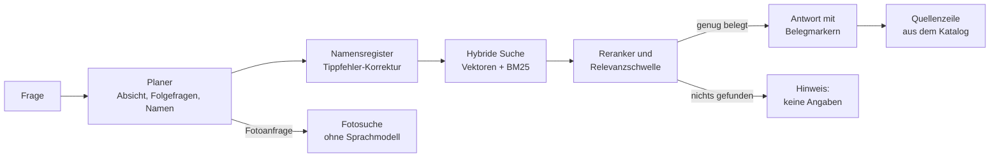

# Museum Hybrid RAG

[English](README.md) · **Deutsch**

Ein Chat-Assistent für das Dorfmuseum Birmensdorf der Heimatkundlichen Vereinigung Birmensdorf (HVB). Er beantwortet Fragen zur Dorfgeschichte aus den digitalisierten Schriften des Museums und findet passende Bilder im Fotoarchiv. Jede Antwort nennt die Quelle mit Heft und Seite.

> **Status (16.11.2026): MVP im Testbetrieb.** Das MVP (Minimum Viable Product, die erste voll funktionsfähige Version mit dem Kernumfang) ist fertig und hat das technische und funktionale Testing samt gemessener Evaluation durchlaufen. Es läuft im Web und auf Telegram, ist aber noch nicht öffentlich zugänglich. Geöffnet wird es, wenn die Rechte mit dem Verein geklärt sind und der Verein zugestimmt hat. Texte, Fotos und Bestandsdaten des Museums gehören nicht zu diesem Repository.

Projektseite: <https://museum-rag.bh-automation.cloud>

## Ausgangslage

Die HVB hat über Jahrzehnte Schriften zur Dorfgeschichte herausgegeben und ein Fotoarchiv aufgebaut. Das Wissen steckt in PDF-Dateien und in der Museumsdatenbank MuseumPro, die auf FileMaker aufbaut. Wer etwas über einen bestimmten Hof, eine Strasse oder eine Familie wissen will, muss die Hefte kennen oder sich mit jemandem vom Museum an den Computer oder in den Archivraum setzen.

Eine einfache Vektorsuche reichte dafür nicht aus. Sie fand allgemeine Themen gut, scheiterte aber an dem, wonach im Dorf am häufigsten gefragt wird: Eigennamen von Höfen, Flurnamen, Familiennamen und Hausnummern. Schon ein Tippfehler im Namen führte ins Leere. Ohne Gegenmassnahmen erfand das Sprachmodell zudem gelegentlich Seitenzahlen.

## Was das System kann

- **Fragen zur Dorfgeschichte beantworten**, gestützt auf 2'543 Textabschnitte aus 24 Publikationen. Die Quellenzeile mit Heft und Seite erzeugt der Programmcode aus einem geprüften Katalog, nicht das Sprachmodell.
- **Fotos suchen** in 1'786 inventarisierten Einträgen. Die Suche unterscheidet, ob jemand auf dem Bild zu sehen ist oder fotografiert hat, und kommt ohne Sprachmodell aus.
- **Tippfehler auffangen** über ein Namensregister mit 8'331 Personen, Gebäuden, Adressen und Flurnamen.
- **Folgefragen verstehen** wie «Wann wurde es gebaut?» oder «Gibt es dazu Fotos?».
- **Allgemeine und spezifische Quellen auseinanderhalten:** Jeder Abschnitt trägt Gemeinde und Quellenart als Metadaten. Ein grosses regionales Standardwerk verdrängt so die Vereinsschriften nicht, und Fragen zu Nachbargemeinden funktionieren trotzdem.
- **Lücken benennen:** Steht zu einer Frage nichts in den Schriften, sagt das System das, statt eine Antwort zu erfinden. Bei Teilwissen beantwortet es den belegten Teil und nennt, was fehlt.

## Wie es funktioniert

1. **Planer:** Ein einziger Aufruf an das Sprachmodell erkennt die Absicht (Wissensfrage, Fotosuche, Begrüssung), löst Bezüge auf frühere Fragen auf und zieht Namen heraus.
2. **Namensregister:** Namen werden mit dem Register abgeglichen und bei Tippfehlern korrigiert. Der Abgleich läuft im Arbeitsspeicher und dauert weniger als eine Millisekunde.
3. **Suche:** Fragen nach Namen und Adressen laufen über eine wortgenaue Registersuche. Offene Sachthemen laufen über eine hybride Suche, die Vektorsuche und Stichwortsuche (BM25) mit Reciprocal Rank Fusion verbindet.
4. **Reranker und Schwelle:** Ein Sprachmodell bewertet die gefundenen Stellen. Liegt keine über der Schwelle, bricht das System vor der Antwort ab.
5. **Antwort und Quellen:** Das Sprachmodell schreibt die Antwort und setzt nur nummerierte Marker. Die sichtbare Quellenzeile baut der Code aus dem Katalog.

Jeder Textabschnitt wurde beim Einlesen mit einer Kopfzeile zu Werk, Kapitel und Jahr versehen (Contextual Retrieval). Silbentrennungen sind bereinigt, und Absätze über Seitengrenzen hinweg sind zusammengeführt.

## Ergebnisse

Jede Änderung wurde vor der Übernahme gegen ein festes Testset (Ground Truth) mit 98 Testfällen in vier Suiten gemessen (Regressionstests). Die Testfragen enthalten Inhalte aus dem Archiv und werden deshalb nicht veröffentlicht.

| Messgrösse | Erster Wurf | MVP |
| --- | ---: | ---: |
| Textsuche: Trefferquote bei Fragen zu Namen und Adressen | 77.3 % | 98.7 % |
| Textsuche: Trefferquote bei Sachthemen | 45.0 % | 79.4 % |
| Textsuche: Fragen ohne Beleg korrekt mit «keine Angaben» beantwortet | 4 von 5 | 5 von 5 |
| Textsuche: Lücken bei mehrteiligen Fragen korrekt benannt | – | 4 von 4 |
| Fotosuche: richtige Bilder unter den ersten 10 | 29.9 % | 94.2 % |
| Fotosuche: Anteil richtiger Bilder unter den ersten 5 | 33.3 % | 95.0 % |
| Erkennung der Absicht | 33 von 40 | 40 von 40 |
| Folgefragen im Dialog richtig verstanden | 13 von 15 | 15 von 15 |

Erster Wurf ist der Stand vom 28. und 29.10.2026, gemessen mit demselben Testset wie das MVP (Stand 16.11.2026). Alle Läufe nutzen gpt-4o-mini von OpenAI. Ein Vergleich mit dem grösseren gpt-4o brachte keine höhere Trefferquote, deshalb blieb es beim kleineren und deutlich günstigeren Modell.

## Technik

| Bereich | Eingesetzt |
| --- | --- |
| Backend | Python 3.11, FastAPI, Pydantic, eigener Code ohne LangChain oder LlamaIndex |
| Sprachmodell | OpenAI gpt-4o-mini für Planung, Reranking und Antworten |
| Embeddings | OpenAI text-embedding-3-small (dicht), FastEmbed BM25 deutsch (lokal) |
| Vektordatenbank | Qdrant 1.16.1, selbst betrieben in Docker |
| Namensregister | RapidFuzz |
| Oberflächen | Streamlit (Web), Telegram-Bot |
| Betrieb | Docker Compose, Traefik mit Let's Encrypt, Nginx für Bilder, Linux-Server in Europa |
| Protokoll und Observability | SQLite, pseudonym: gesalzener Hash als Sitzungsschlüssel, keine IP-Adressen, Fragetexte nach 90 Tagen gelöscht. Geplant ist Langfuse (selbst betrieben) für Tracing |

Die Programmierschnittstelle und die Datenbank sind von aussen nicht erreichbar. Öffentlich sind nur die Web-Oberfläche und der Telegram-Webhook, dieser mit geheimem Token. Anfragen sind pro Sitzung begrenzt (Rate Limiting).

## Governance

Das Projekt folgt wenigen Grundsätzen, ausführlich beschrieben auf der [Projektseite](https://museum-rag.bh-automation.cloud/#spielregeln):

- **Antworten nur mit Beleg.** Eine Relevanzschwelle stoppt das System, bevor es eine Antwort ohne Stütze in den Quellen erzeugt. Die Quellenzeile baut der Code, nicht das Sprachmodell.
- **Messen vor dem Übernehmen.** Keine Änderung geht ohne Lauf gegen das Testset live.
- **Rechte zuerst.** Texte und Fotos gehören dem Museum. Die Persönlichkeitsrechte der im Archiv genannten oder abgebildeten Personen werden vor der Öffnung geklärt.
- **Datenminimierung.** Das Protokoll speichert keine IP-Adressen und nur eine pseudonyme Sitzungskennung. Weil eine Frage selbst Namen enthalten kann, löscht das System die Fragetexte nach 90 Tagen automatisch, und der Chat weist darauf hin, dass eine KI antwortet.

## Was in diesem Repository liegt

| Pfad | Inhalt |
| --- | --- |
| `README.md`, `README.de.md` | Diese Übersicht auf Englisch und Deutsch |
| [`documentation/architecture.md`](documentation/architecture.md#deutsche-fassung) | Bausteine, Ablauf einer Anfrage, Aufbereitung der Inhalte, Betrieb |
| [`documentation/decisions.md`](documentation/decisions.md#deutsche-fassung) | Elf wichtige Designentscheide mit Begründung und gemessener Wirkung |
| [`documentation/evaluation.md`](documentation/evaluation.md#deutsche-fassung) | Testset, Messgrössen, Ergebnisse Schritt für Schritt, Grenzen |
| [`documentation/legal-considerations.md`](documentation/legal-considerations.md#deutsche-fassung) | Rechtliche Punkte, die vor der Öffnung eines solchen Werkzeugs zu klären sind |
| `docs/` | Die Projektseite (GitHub Pages), Deutsch und Englisch |
| `CHANGELOG.md` | Änderungen an diesem Repository |
| `SECURITY.md` | Melden von Sicherheitslücken |
| `LICENSE` | MIT-Lizenz für den Code |

Die Dokumente unter `documentation/` enthalten eine englische und eine deutsche Fassung in derselben Datei.

Als Nächstes folgt der Anwendungscode mit einem kleinen, erfundenen Demo-Datensatz, mit dem sich das System lokal starten lässt. Er folgt, wenn die Rechte mit dem Verein geklärt sind.

Nicht veröffentlicht werden die Schriften und Fotos des Museums, das Namensregister, die Testfragen und alle Daten aus dem Betrieb. Die Rechte daran liegen bei der HVB.

## Lizenz

Der Code steht unter der MIT-Lizenz. Texte und Fotos des Museums sind nicht Teil dieses Repositorys und nicht von der Lizenz erfasst.

## Kontakt

Beat Hutter · [LinkedIn](https://www.linkedin.com/in/beat-hutter-2687414b/) · [Projektseite](https://museum-rag.bh-automation.cloud)
