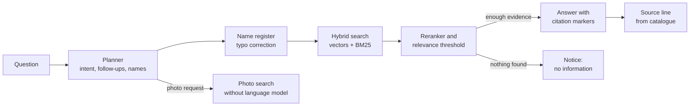

# Museum Hybrid RAG

**English** · [Deutsch](README.de.md)

A chat assistant for the village museum of Birmensdorf, Switzerland, run by the Heimatkundliche Vereinigung Birmensdorf (HVB), the local history society. It answers questions about the village's history from the museum's digitised publications and finds matching pictures in the photo archive. Every answer cites its source by issue and page.

> **Status (16 November 2026): MVP in test operation.** The MVP (minimum viable product, the first fully working version with the core scope) is complete and has passed technical and functional testing including a measured evaluation. It runs on the web and on Telegram but is not open to the public yet. It will be opened once the rights have been clarified with the society and the society has agreed. The museum's texts, photos and collection data are not part of this repository.

Project page: <https://museum-rag.bh-automation.cloud>

## Background

Over several decades the HVB has published booklets on local history and built up a photo archive. That knowledge sits in PDF files and in the museum database MuseumPro, which is built on FileMaker. Anyone looking for a particular farmstead, street or family has to know which booklet to open, or sit down with someone from the museum at the computer or in the archive room.

Plain vector search was not enough. It handled general topics well but failed at what people in the village ask about most: names of farmsteads, field names, family names and house numbers. A single typo in a name led nowhere. Without safeguards the language model also occasionally invented page numbers.

## What it does

- **Answers questions about local history** from 2,543 text passages taken from 24 publications. The source line with issue and page is generated by code from a verified catalogue, not by the language model.
- **Searches photos** across 1,786 catalogued entries. The search distinguishes between someone who appears in a picture and someone who took it, and runs without a language model.
- **Handles typos** through a name register of 8,331 people, buildings, addresses and field names.
- **Understands follow-up questions** such as "When was it built?" or "Are there photos of it?".
- **Keeps general and specific sources apart:** every passage carries its municipality and source type as metadata. A large regional reference work therefore does not crowd out the society's own booklets, and questions about neighbouring villages still work.
- **States what is missing:** if the publications contain nothing on a question, the system says so instead of inventing an answer. For partial knowledge it answers the part it can support and names what is missing.

## How it works

1. **Planner:** a single call to the language model detects the intent (knowledge question, photo search, greeting), resolves references to earlier questions and extracts names.
2. **Name register:** names are matched against the register and corrected if misspelled. Matching runs in memory and takes less than a millisecond.
3. **Search:** questions about names and addresses use an exact-word register search. Open topics use a hybrid search that combines vector search and keyword search (BM25) with Reciprocal Rank Fusion.
4. **Reranker and threshold:** a language model scores the retrieved passages. If none is above the threshold, the system stops before generating an answer.
5. **Answer and sources:** the language model writes the answer and only inserts numbered markers. The visible source line is built by code from the catalogue.

During ingestion every text passage was given a header with work, chapter and year (contextual retrieval). Hyphenation is cleaned up and paragraphs spanning page breaks are merged.

## Results

Every change was measured against a fixed test set (ground truth) with 98 test cases in four suites before it was adopted (regression testing). The test questions contain material from the archive and are therefore not published.

| Metric | First version | MVP |
| --- | ---: | ---: |
| Text search: recall for questions about names and addresses | 77.3 % | 98.7 % |
| Text search: recall for topical questions | 45.0 % | 79.4 % |
| Text search: questions without evidence correctly answered with "no information" | 4 of 5 | 5 of 5 |
| Text search: gaps named correctly in multi-part questions | – | 4 of 4 |
| Photo search: correct pictures among the top 10 | 29.9 % | 94.2 % |
| Photo search: share of correct pictures among the top 5 | 33.3 % | 95.0 % |
| Intent detection | 33 of 40 | 40 of 40 |
| Follow-up questions understood correctly | 13 of 15 | 15 of 15 |

The first version is the state of 28 and 29 October 2026, measured with the same test set as the MVP (state of 16 November 2026). All runs use OpenAI gpt-4o-mini. A comparison with the larger gpt-4o showed no gain in recall, so the smaller and much cheaper model was kept.

## Technology

| Area | Used |
| --- | --- |
| Backend | Python 3.11, FastAPI, Pydantic, custom code without LangChain or LlamaIndex |
| Language model | OpenAI gpt-4o-mini for planning, reranking and answers |
| Embeddings | OpenAI text-embedding-3-small (dense), FastEmbed BM25 for German (local) |
| Vector database | Qdrant 1.16.1, self-hosted in Docker |
| Name register | RapidFuzz |
| Interfaces | Streamlit (web), Telegram bot |
| Operations | Docker Compose, Traefik with Let's Encrypt, Nginx for images, Linux server in Europe |
| Logging and observability | SQLite, pseudonymous: salted hash as session key, no IP addresses, question texts deleted after 90 days. Langfuse (self-hosted) is planned for tracing |

The API and the database are not reachable from outside. Only the web interface and the Telegram webhook are public, the latter protected by a secret token. Requests are rate-limited per session.

## Governance

The project follows a small set of principles, described in full on the [project page](https://museum-rag.bh-automation.cloud/en/#principles):

- **Answers only with evidence.** A relevance threshold stops the system before it generates an answer without support in the sources. Source lines are built by code, not by the language model.
- **Measure before adopting.** No change goes live without a run against the test set.
- **Rights first.** The texts and photos belong to the museum. Personal rights (people named or shown in the archive) are being clarified before the system is opened to the public.
- **Data minimisation.** The log stores no IP addresses and only a pseudonymous session key. Because a question itself may contain names, question texts are deleted automatically after 90 days, and the chat states that an AI is answering.

## What is in this repository

| Path | Content |
| --- | --- |
| `README.md`, `README.de.md` | This overview in English and German |
| [`documentation/architecture.md`](documentation/architecture.md) | Components, request flow, content preparation, operation |
| [`documentation/decisions.md`](documentation/decisions.md) | Eleven key design decisions with reasoning and measured effect |
| [`documentation/evaluation.md`](documentation/evaluation.md) | Test set, metrics, results step by step, limitations |
| [`documentation/legal-considerations.md`](documentation/legal-considerations.md) | Legal points to clarify before opening such a tool to the public |
| `docs/` | The project page (GitHub Pages), German and English |
| `CHANGELOG.md` | Changes to this repository |
| `SECURITY.md` | How to report security issues |
| `LICENSE` | MIT License for the code |

The documents in `documentation/` contain an English and a German version in the same file.

Next to follow: the application code together with a small, made-up demo dataset that lets you run the system locally. It follows once the rights have been clarified with the society.

The museum's publications and photos, the name register, the test questions and all operational data are not published. The rights to them belong to the HVB.

## License

The code is licensed under the MIT License. The museum's texts and photos are not part of this repository and are not covered by the license.

## Contact

Beat Hutter · [LinkedIn](https://www.linkedin.com/in/beat-hutter-2687414b/) · [Project page](https://museum-rag.bh-automation.cloud)
