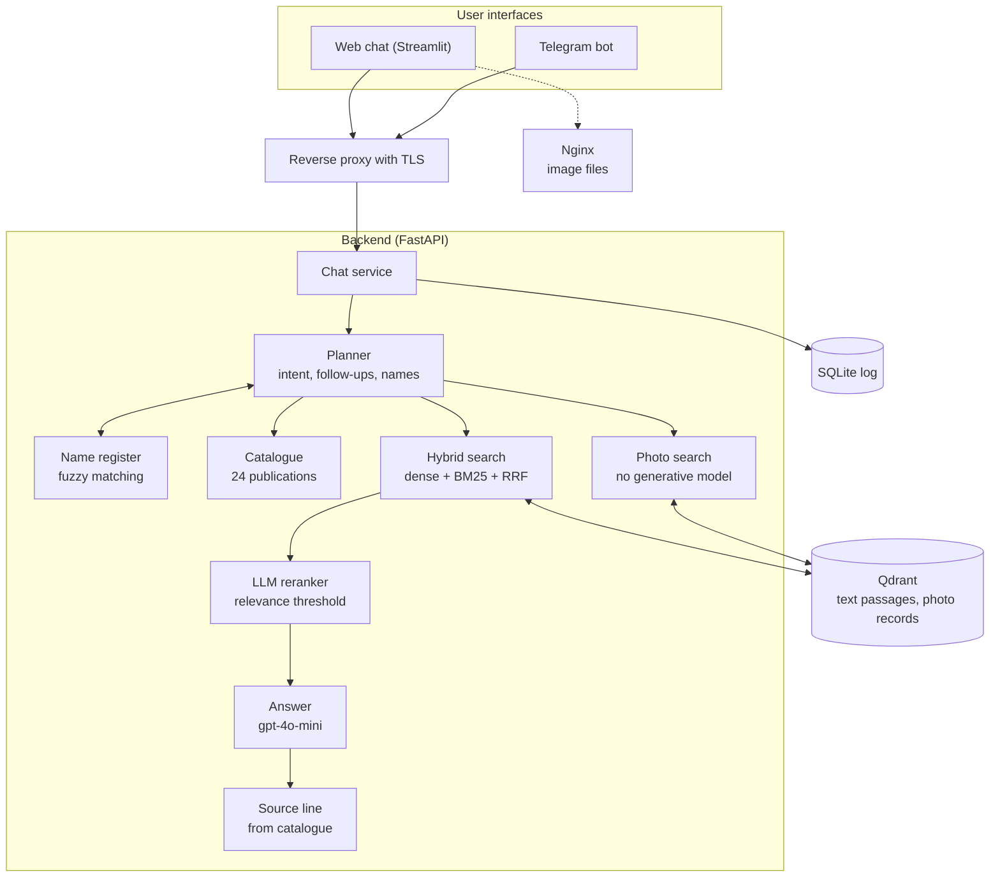
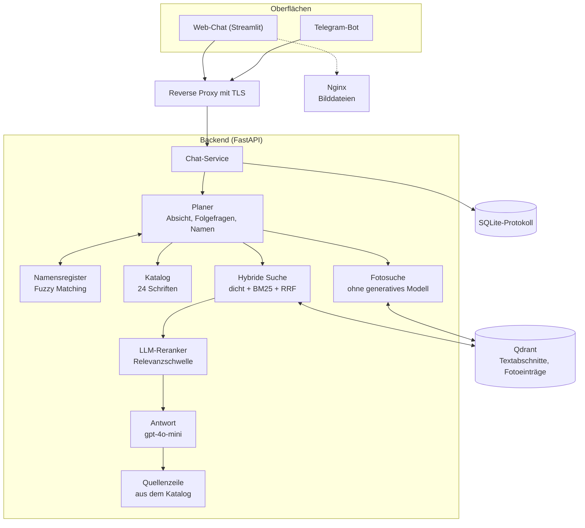

# Architecture

**English** · [Deutsch](#deutsche-fassung)

> A German version follows below. · Eine deutsche Fassung folgt weiter unten.

This document describes how the Museum Hybrid RAG system is built: its components, how a question flows through them, how the content is prepared, and how the system is operated. It reflects the MVP as of November 2026.

## Overview

The system answers questions about the history of a Swiss village from the museum's publications and finds matching photos in its photo archive. It has two search paths:

- **Knowledge questions (RAG path):** hybrid search in the text passages, reranking, a relevance threshold, and an answer from the language model with a source line built by code.
- **Photo search (gallery path):** search in the photo catalogue with metadata filters, without a generative language model.

Questions about the collection itself ("Which publications are there?") are answered directly from a verified catalogue. Greetings are answered without any model call.

## Components

| Component | Responsibility |
| --- | --- |
| Chat service | Single entry point for both channels. Web and Telegram only handle transport and display. |
| Planner | One language model call with Structured Outputs: detects the intent, rewrites follow-up questions into standalone questions, extracts names and places, decides between name search and topic search. |
| Name register | 8,331 people, buildings, addresses and field names with their spelling variants. Held in memory, fuzzy matching corrects typos in under a millisecond. |
| Catalogue | Verified master data of all 24 publications (title, series, issue, author, year, type). Source of every citation and of answers about the collection. |
| Hybrid search | Dense vectors and BM25 in Qdrant, fused with Reciprocal Rank Fusion. Exact word search for names and addresses. Metadata filters for municipality and source type. |
| Reranker and threshold | A language model scores up to 35 candidate pages on a scale of 0 to 3. If no page reaches the threshold, the system answers "no information" without generating text. |
| Answer and source line | The language model writes the answer with numbered markers only. Code validates the markers, removes them and builds the source line from the catalogue. |
| Photo search | Separates people shown in a picture from people who took it, filters by year, uses exact word conditions for names and hybrid search for topics. |
| Log | Timestamp, channel, question, latency, hit count and ratings, with a pseudonymous session key and no IP addresses. |

## How a knowledge question is answered

1. **Planning:** the planner reads the question and the recent conversation. "When was it built?" becomes a complete question with the building's name (query rewriting).
2. **Name matching:** names are matched against the register. A misspelled name is corrected to its canonical form, and all known spellings are collected for the search.
3. **Retrieval:**
   - Questions about names and addresses use an exact word search with word boundaries, so house number 2 does not match 20.
   - Open topics use hybrid search. The query is expanded with typical historical terms for the topic.
   - Metadata filters keep the answer within the municipality in question.
4. **Reranking and threshold:** the language model scores the candidate pages (LLM as a judge). Pages below the threshold are dropped. If none is left, the system stops here.
5. **Photo hint:** in parallel, the system counts matching photos and offers a button to view them.
6. **Answer:** the language model answers only from the passages it was given (grounding). If part of a question is not covered, it says what is missing instead of filling the gap.
7. **Source line:** code turns the markers into a citation with title, issue and page from the catalogue.

## How a photo search works

1. The planner recognises a photo request and extracts the subject, the role (shown or photographer) and an optional year range.
2. The register supplies all spellings of a name.
3. Names and addresses are searched with exact word conditions; topics with hybrid search and a minimum similarity.
4. Results are grouped (shown in the picture, taken by), paginated and displayed with thumbnails. No generative model is involved, which keeps the photo search fast and predictable.

## Content preparation (ingestion pipeline)

The quality of the answers depends mostly on how the content is prepared. The pipeline runs locally and writes to the database on the server.

- **Text extraction and cleaning:** page numbers are removed, hyphenation at line ends is resolved (more than 5,000 split words), and paragraphs that run across a page break are merged.
- **Chunking:** passages of two to three paragraphs with overlap, so that stories and descriptions are not cut in the middle. Pages with lists of publications are marked and excluded from normal search.
- **Contextual retrieval:** every passage gets a header with work, chapter or narrator, year and a short summary. The header is used for the vectors; the answer model sees the clean original text.
- **Search on the original text:** the unchanged original text is indexed, so that names, dates and house numbers are preserved. Only the few passages in Swiss German get an additional Standard German translation for the vector search.
- **Metadata:** source, pages, municipality and source type for filtering and citations.
- **Name register:** names are extracted from all passages and photo records with a language model, consolidated and merged across spelling variants. Results are cached so that new documents can be added incrementally.
- **Photo catalogue:** 14 relevant fields from the museum database, with descriptive text kept separate from the photographer.

## Operation

- **Hosting:** Docker Compose on a Linux server in Europe: backend, web frontend, Qdrant and an Nginx container for images.
- **Network:** the reverse proxy terminates TLS and only exposes the web interface, the Telegram webhook and the images. The API and the database are not reachable from outside; the frontend talks to the backend inside the Docker network.
- **Protection:** the Telegram webhook checks a secret token; requests are rate-limited per session; CORS is restricted to the chat.
- **Maintenance:** ingestion and administration run through an SSH tunnel. The database version is pinned so that deployments are reproducible.
- **Secrets:** API keys live in an environment file on the server, never in the repository.

## Observability

Every request is logged with latency, hit count and optional rating. A report shows which questions remain open and where the system is weak. A self-hosted tracing tool such as Langfuse is planned, with personal data masked before storage. Before the public launch, the log will get a fixed retention period with automatic deletion.

## Technology

Python 3.11, FastAPI, Pydantic, Qdrant 1.16, OpenAI gpt-4o-mini and text-embedding-3-small, FastEmbed (BM25), RapidFuzz, Streamlit, python-telegram-bot, SQLite, Docker Compose, Traefik, Nginx. No LangChain or LlamaIndex; see [decisions.md](decisions.md).

---

## Deutsche Fassung

# Architektur

Dieses Dokument beschreibt den Aufbau des Systems Museum Hybrid RAG: die Bausteine, den Weg einer Frage durch das System, die Aufbereitung der Inhalte und den Betrieb. Es entspricht dem MVP mit Stand November 2026.

## Überblick

Das System beantwortet Fragen zur Geschichte eines Schweizer Dorfes aus den Schriften des Museums und findet passende Fotos im Fotoarchiv. Es hat zwei Suchpfade:

- **Wissensfragen (RAG-Pfad):** hybride Suche in den Textabschnitten, Reranking, Relevanzschwelle und eine Antwort des Sprachmodells mit einer Quellenzeile aus dem Code.
- **Fotosuche (Galerie-Pfad):** Suche im Fotokatalog mit Metadaten-Filtern, ohne generatives Sprachmodell.

Fragen zum Bestand selbst («Welche Schriften gibt es?») beantwortet das System direkt aus einem geprüften Katalog. Begrüssungen beantwortet es ganz ohne Modellaufruf.

## Bausteine

| Baustein | Aufgabe |
| --- | --- |
| Chat-Service | Gemeinsamer Einstieg für beide Kanäle. Web und Telegram kümmern sich nur um Übertragung und Darstellung. |
| Planer | Ein Aufruf an das Sprachmodell mit Structured Outputs: erkennt die Absicht, formuliert Folgefragen zu eigenständigen Fragen um, zieht Namen und Orte heraus und entscheidet zwischen Namenssuche und Themensuche. |
| Namensregister | 8'331 Personen, Gebäude, Adressen und Flurnamen mit ihren Schreibweisen. Liegt im Arbeitsspeicher; Fuzzy Matching korrigiert Tippfehler in weniger als einer Millisekunde. |
| Katalog | Geprüfte Stammdaten aller 24 Schriften (Titel, Reihe, Heft, Autor, Jahr, Art). Quelle jeder Quellenangabe und der Antworten zum Bestand. |
| Hybride Suche | Dichte Vektoren und BM25 in Qdrant, verbunden über Reciprocal Rank Fusion. Wortgenaue Suche bei Namen und Adressen. Metadaten-Filter für Gemeinde und Quellenart. |
| Reranker und Schwelle | Ein Sprachmodell bewertet bis zu 35 Kandidatenseiten auf einer Skala von 0 bis 3. Erreicht keine Seite die Schwelle, antwortet das System mit «keine Angaben», ohne Text zu erzeugen. |
| Antwort und Quellenzeile | Das Sprachmodell schreibt die Antwort und setzt nur nummerierte Marker. Der Code prüft die Marker, entfernt sie und baut die Quellenzeile aus dem Katalog. |
| Fotosuche | Trennt abgebildete Personen von Fotografierenden, filtert nach Jahren, nutzt wortgenaue Bedingungen für Namen und hybride Suche für Sachthemen. |
| Protokoll | Zeitpunkt, Kanal, Frage, Antwortzeit, Trefferzahl und Bewertungen, mit pseudonymer Sitzungskennung und ohne IP-Adressen. |

## Wie eine Wissensfrage beantwortet wird

1. **Planung:** Der Planer liest die Frage und den bisherigen Gesprächsverlauf. Aus «Wann wurde es gebaut?» wird eine vollständige Frage mit dem Namen des Gebäudes (Query Rewriting).
2. **Namensabgleich:** Namen werden mit dem Register abgeglichen. Ein falsch geschriebener Name wird auf die kanonische Form korrigiert, und alle bekannten Schreibweisen gehen in die Suche.
3. **Suche:**
   - Fragen nach Namen und Adressen laufen über eine wortgenaue Suche mit Wortgrenzen, sodass die Hausnummer 2 nicht die 20 trifft.
   - Offene Sachthemen laufen über die hybride Suche. Die Anfrage wird um typische historische Fachbegriffe zum Thema erweitert.
   - Metadaten-Filter halten die Antwort bei der gefragten Gemeinde.
4. **Reranking und Schwelle:** Das Sprachmodell bewertet die Kandidatenseiten (LLM as a Judge). Seiten unter der Schwelle fallen weg. Bleibt keine übrig, hört das System hier auf.
5. **Foto-Hinweis:** Parallel zählt das System passende Fotos und bietet einen Knopf an, um sie anzusehen.
6. **Antwort:** Das Sprachmodell antwortet nur aus den übergebenen Textstellen (Grounding). Ist ein Teil der Frage nicht belegt, sagt es, was fehlt, statt die Lücke zu füllen.
7. **Quellenzeile:** Der Code macht aus den Markern eine Quellenangabe mit Titel, Heft und Seite aus dem Katalog.

## Wie eine Fotosuche abläuft

1. Der Planer erkennt eine Fotoanfrage und zieht das Motiv, die Rolle (abgebildet oder fotografiert) und einen allfälligen Jahresbereich heraus.
2. Das Register liefert alle Schreibweisen eines Namens.
3. Namen und Adressen werden mit wortgenauen Bedingungen gesucht, Sachthemen mit hybrider Suche und einer Mindestähnlichkeit.
4. Die Treffer werden gruppiert (abgebildet, fotografiert von), seitenweise angezeigt und mit Vorschaubildern dargestellt. Ein generatives Modell ist nicht beteiligt. Das hält die Fotosuche schnell und vorhersehbar.

## Aufbereitung der Inhalte (Ingestion Pipeline)

Die Qualität der Antworten hängt vor allem davon ab, wie die Inhalte aufbereitet sind. Die Pipeline läuft lokal und schreibt in die Datenbank auf dem Server.

- **Textextraktion und Bereinigung:** Seitenzahlen werden entfernt, Silbentrennungen am Zeilenende aufgelöst (über 5'000 getrennte Wörter), und Absätze über einen Seitenwechsel hinweg zusammengeführt.
- **Chunking:** Abschnitte aus zwei bis drei Absätzen mit Überlappung, damit Erzählungen und Beschreibungen nicht mittendrin abbrechen. Seiten mit Schriftenverzeichnissen werden markiert und aus der normalen Suche ausgeschlossen.
- **Contextual Retrieval:** Jeder Abschnitt erhält eine Kopfzeile mit Werk, Kapitel oder Erzähler, Jahr und einer kurzen Zusammenfassung. Die Kopfzeile fliesst in die Vektoren ein; das Antwortmodell sieht den sauberen Originaltext.
- **Suche auf dem Originaltext:** Indexiert wird der unveränderte Originaltext, damit Namen, Jahreszahlen und Hausnummern erhalten bleiben. Nur die wenigen Abschnitte in Mundart erhalten für die Vektorsuche zusätzlich eine hochdeutsche Übersetzung.
- **Metadaten:** Quelle, Seiten, Gemeinde und Quellenart für Filter und Quellenangaben.
- **Namensregister:** Namen werden mit einem Sprachmodell aus allen Abschnitten und Fotoeinträgen gezogen, bereinigt und über Schreibweisen hinweg zusammengeführt. Die Ergebnisse sind zwischengespeichert, sodass neue Dokumente schrittweise dazukommen können.
- **Fotokatalog:** 14 relevante Felder aus der Museumsdatenbank; der beschreibende Text ist vom Fotografen getrennt.

## Betrieb

- **Hosting:** Docker Compose auf einem Linux-Server in Europa: Backend, Web-Oberfläche, Qdrant und ein Nginx-Container für die Bilder.
- **Netzwerk:** Der Reverse Proxy übernimmt die TLS-Verschlüsselung und macht nur die Web-Oberfläche, den Telegram-Webhook und die Bilder erreichbar. Programmierschnittstelle und Datenbank sind von aussen nicht erreichbar; die Web-Oberfläche spricht im Docker-Netz mit dem Backend.
- **Schutz:** Der Telegram-Webhook prüft ein geheimes Token, Anfragen sind pro Sitzung begrenzt, CORS ist auf den Chat beschränkt.
- **Wartung:** Ingestion und Administration laufen über einen SSH-Tunnel. Die Version der Datenbank ist fest gepinnt, damit Deployments reproduzierbar sind.
- **Geheimnisse:** API-Schlüssel liegen in einer Umgebungsdatei auf dem Server, nie im Repository.

## Observability

Jede Anfrage wird mit Antwortzeit, Trefferzahl und allfälliger Bewertung protokolliert. Ein Bericht zeigt, welche Fragen offen bleiben und wo das System schwächelt. Geplant ist ein selbst betriebenes Tracing-Werkzeug wie Langfuse, das Personendaten vor dem Speichern maskiert. Vor der Öffnung erhält das Protokoll eine feste Aufbewahrungsfrist mit automatischer Löschung.

## Technik

Python 3.11, FastAPI, Pydantic, Qdrant 1.16, OpenAI gpt-4o-mini und text-embedding-3-small, FastEmbed (BM25), RapidFuzz, Streamlit, python-telegram-bot, SQLite, Docker Compose, Traefik, Nginx. Kein LangChain oder LlamaIndex; siehe [decisions.md](decisions.md).
